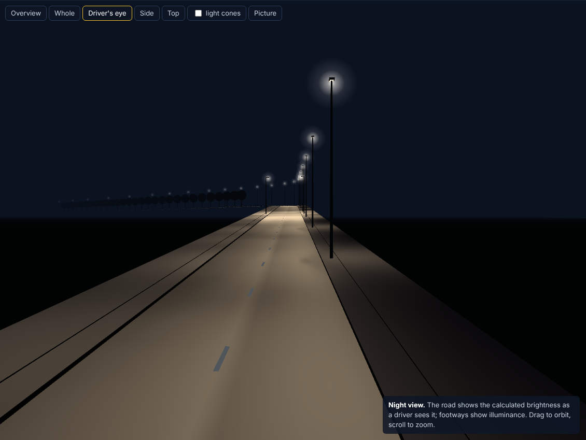

# Street Lighting

Road and street lighting design to **EN 13201** (with CIE 140) and **ANSI/IESNA RP-8-00** — from the
luminaire's photometric file to pole height and spacing along a real route with bends, hills and
trees, with contours, cabling, columns, energy figures, CAD drawings and a bilingual report.

**▶ Open the online app: [emadroshandel.github.io/Street_Lighting](https://emadroshandel.github.io/Street_Lighting/)**
— nothing to install. The first visit downloads the Python engine (about 10 MB); after that it is cached.

The same application runs **on your computer** (desktop window or browser, fully offline) and
**online** from GitHub Pages, where the identical Python engine runs inside the browser.



---

## 1. What it does

| Step | You give | The application works out |
|---|---|---|
| 1 Luminaire | IES (LM-63) or EULUMDAT files, or just the lamp (LED, HPS, MH, MV, LPS, CFL, induction) | luminaire flux, LOR/ULOR, efficacy, polar curves, installed intensity class G\*, glare index class D, maintenance factor (CIE 154) |
| 2 Road | strips of the cross-section: carriageways, footways, verges, medians, cycle tracks, parking | lighting class of every strip (with the CEN/TR 13201-1 class selector), road surface R1–R4 |
| 3 Route | straight, straights and bends, drawn on the plan, or imported (DXF, GeoJSON, KML, GPX, CSV); vertical profile; tree lines; crossings; junctions; no-pole zones; overhead lines | what the topology asks of the design |
| 4 Design | search ranges and costs | every arrangement × height × arm × tilt, the longest spacing that meets every class, the dimming level, ranked by life-cycle cost |
| 5 Results | — | each EN 13201-2 criterion with value, requirement and the *reason* it passes or fails; isolux and isoluminance contours; 3D night view |
| 6 On the route | layout rules | poles placed along the real road, spacing tightened on bends and crests, poles on the outside of bends, extra luminaires at crossings, poles at junctions, obstructions avoided; every span calculated and refined until it complies |
| 7 Electrical | supply system, cable type, protection | feeder pillar positions, circuits and phases, cable sizes, voltage drop, fault-loop impedance, short-circuit withstand, single-line diagram |
| 8 Columns | wind and soil | wind load, column section, deflection and foundation depth |
| 9 Energy | operating profile, tariff | PDI and AECI (EN 13201-5), kWh, cost and CO₂ per year |
| 10 Report | language | printable report in English, Persian or both; DXF drawings; CSV schedules |

## 2. Running it

### 2.1 On Windows

Install Python 3.9 or newer (tick *Add python.exe to PATH*), then double-click

* **`Run Street Lighting (desktop).bat`** — opens a desktop window (or your browser if
  `pywebview` is not installed), or
* **`Run Street Lighting (browser).bat`** — opens it in your browser.

NumPy is installed automatically on the first run. For the native window:
`py -3 -m pip install pywebview`.

### 2.2 On Linux / macOS

```
python3 -m pip install numpy
python3 desktop.py          # or: python3 server.py
```

`python3 server.py --lan` makes the application reachable from other computers on the network.

### 2.3 Online

After the repository is pushed to GitHub with Pages enabled (*Settings → Pages → Source:
GitHub Actions*), the workflow in `.github/workflows/pages.yml` runs the tests and publishes the
site at https://emadroshandel.github.io/Street_Lighting/. The first visit downloads Python
(Pyodide, about 10 MB) and is then cached.

### 2.4 Help on every input

Every value you enter has a small **?** beside its label. Hover it to see what the parameter
is, its reasonable range and why the design needs it; click it to keep the explanation open
(Esc closes it). **Explain all** in the top bar shows every explanation under its field.

Removing a luminaire, a strip or a table row, or replacing the strips with a road template, can
be reversed with **Undo** in the message that appears. The interface is designed to WCAG 2.2 AA for
text contrast, keyboard focus and target size (checked by `tests/ui_check.py`, not by an
accessibility audit), is usable on a phone, and respects the system's *reduce motion* setting.

### 2.5 Charts and the 3D view

The span charts and the vertical profile are interactive: hover (or Tab to) a span to see each
criterion with its value and requirement, hover the road for chainage, level and grade, and hover a
column to read why it stands where it does (bend, crest, junction, obstruction…). Ctrl + wheel or
the + / − buttons zoom along the road; every chart also has a table of values. The 3D view draws
repeated parts (columns, heads, trees, markings) as instanced meshes and renders only when
something changes, so long routes stay smooth on ordinary laptops.

### 2.6 Browser check before a release

`python tests/ui_check.py` (needs `pip install playwright` and `python -m playwright install
chromium` once) starts the application, runs a whole design in a browser and checks the 3D view,
charts, keyboard access, help badges, Undo, the report dialog, contrast and labels, and the
phone-width layout. Add `--shots folder` to save screenshots.

## 3. The calculation

### 3.1 Photometry

IES LM-63 (1986–2019, type C) and EULUMDAT (all symmetry indicators) are read into one full
C 0–360° × γ 0–180° table of absolute candela. Interpolation is linear, first in C and then in γ
(EN 13201-3 clause 5.2.2). The street side (C90 or C270) is detected and the luminaire turned
automatically. The engine takes C0–C180 along the road; a file whose along-road axis is on
90–270 instead (mirror-symmetric in the C0–C180 plane but not in the C90–C270 plane — common in
IES road files, whose horizontal-angle origin LM-63 leaves open, and the case for the IES files
of the CIE 140 test set) is turned by 90° on reading, with a note. Without a file, a smooth generic road optic (IES type II–V, post-top, pedestrian)
is built from the lamp flux and normalised to the luminaire flux; such designs are marked
*indicative* everywhere.

### 3.2 EN 13201-3 on the straight section

* luminaire attitude by orientation, tilt for calculation (θf − θm) and rotation, in a
  rotation-matrix form equivalent to Formulae 12–21;
* horizontal, hemispherical, semi-cylindrical and vertical illuminance (Formulae 29–32);
* luminance with the standard CIE r-tables R1–R4, observers 60 m before the field at 1.5 m in
  the centre of each lane, every luminaire inside the r-table (tan ε ≤ 12), which covers the
  minimum 5H / 12H / 5H area of clause 7.1.5;
* grids of clause 7.1.3 and 7.2.7 (N = 10 or the smallest N giving D ≤ 3 m; 3 points per lane;
  d ≤ 1.5 m elsewhere);
* threshold increment fTI with initial values and the veiling-luminance formulae (37) and (38)
  — for 0.1° < θ ≤ 1.5° in the form of CIE 140:2019 Formula (26) and CIE 146, the age factor
  on the 5/θ² term only — reported per observer lane and as the operative maximum; the 20° screening plane through the eye, transverse to the road; observers starting
  2.75 (H − 1.5) before the first luminaire (60 m and no screening plane for H ≤ 2 m, CIE 140)
  and moved over the field, luminaires up to 500 m;
* edge illuminance ratio REI (clause 8.6), assessed only on edges without an adjoining area that
  has its own lighting class (EN 13201-2 Table 1 note d) and treating carriageways ≤ 10 m apart
  as one; P- and C-class glare by Annex C of EN 13201-2.

### 3.3 The search

Illuminance and luminance scale linearly with the flux, so the uniformities depend only on the
geometry and the required dimming level follows directly; fTI scales as f^0.2. For every
arrangement, height, arm and tilt the largest spacing is found by bisection and confirmed with a
full calculation. Candidates are ranked by life-cycle cost per km (columns, luminaires, cable,
energy and maintenance, discounted).

Each luminaire has its own calculation budget, so adding luminaires never crowds others out of the
search. With more than three luminaires, a quick first pass (three heights, two arm lengths, one
tilt, 1 m spacing steps) ranks all of them and only the three cheapest are searched in full; the
results list the quick-pass ranking and any luminaire with no compliant layout. With more than
four luminaires the Design step offers "search every luminaire in full" for a complete (slower)
search.

### 3.4 Topology and the real route

The route is built from straights and circular arcs (or a polyline with fillet radii), with a
vertical profile of PVIs and parabolic vertical curves, and cross-fall. The calculation along
the route uses the real surface normal and an observer 60 m before each span in every lane.

What changes the design, and why:

* **bends** — spacing reduced with the radius, single-sided rows moved to the outside of bends
  with R < 300 m;
* **crests** — spacing reduced and the glare along the route checked (EN 13201-2 A.3.1); if fTI
  fails, a smaller tilt is tried automatically;
* **trees** — crowns are ellipsoids of foliage attenuating light by Beer–Lambert
  (T = e^(−κ·chord)); the search then also tries mounting below or above the crowns and arms
  long enough to reach past them, and luminaires inside a crown are rejected. (EN 13201-3
  disregards obstruction; results with trees are reported in addition.)
* **crossings** — a luminaire before the crossing in each traffic direction (Annex B);
* **junctions** — a pole at the junction mouth (conflict area);
* **no-pole zones and overhead lines** — poles moved clear, heights limited under lines.

Every span is then checked against its class and the stretches that fail are tightened in
rounds of 10 % until the route complies or the iteration limit is reached; a route that still
fails is reported as failing. A column that cannot be moved out of a no-pole zone, or that
an overhead line would force below 2 m, is reported as a failed *Column positions* check rather
than placed silently. Ul is applied only to uninterrupted stretches
(EN 13201-2 Table 1 note a).

### 3.5 Electrical

IEC 60364-5-52 current-carrying capacities (Tables B.52.2–B.52.5, methods D1/D2) with ground
temperature, soil resistivity and grouping factors; Annex G voltage drop computed phase by phase
for the distributed load with the neutral current; Ib ≤ In ≤ Iz (IEC 60364-4-43); automatic
disconnection (IEC 60364-4-41, TN and TT); adiabatic short-circuit withstand; IEC 60228
resistances; gG fuses by the IEC 60269-1 / 60269-2-1 gates (I<sub>max</sub>(5 s); for 0.4 s
I<sub>max</sub>(0.1 s) unless I<sub>a</sub>/I<sub>n</sub> from the fuse curve is entered); LED-driver inrush check. Every pillar position, number of pillars and cable size is
tried and the cheapest compliant arrangement kept.

### 3.6 Columns and energy

Loads to EN 40-3-1:2013: q(10) with C<sub>s</sub> = √0.92 (25-year return period), δ, β for metal
columns (5.2.4) from the natural period found by Rayleigh's method, exposure c<sub>e</sub>(z) of
Tables 2 and 3 (terrain I–IV, default II), shape coefficients of Figure 3 with the Reynolds number
of 5.3, luminaire coefficient 1.0 and its weight 0.4 × its length beyond the bracket.
Verification to EN 40-3-3:2013: load class A or B (Table 1), plastic resistance of the closed
section with the local-buckling factor φ<sub>1</sub> (Figure 2) and γ<sub>m</sub> = 1.05, torsion,
an unreinforced door opening at its lower edge (5.6.2.2, φ<sub>3</sub>–φ<sub>5</sub>), the
interaction Formulae (10) and (11), and the horizontal (Table 4, flexure + torsion) and vertical
deflection. Foundation depth by Broms' method and by the PD 6547 ground factor; the deeper governs.
The closed-section resistance reproduces the worked example of an independent EN 40-3-3 design
report. Energy indicators to EN 13201-5 (PDI, AECI) for full, bi-power or three-level operation;
maintenance factor to CIE 154:2003 Tables 3.1–3.3 (lamp lumen maintenance and survival by burning
hours, luminaire maintenance by IP rating, pollution and cleaning interval).

The electrical step also lists the site requirements of IEC 60364-7-714 (isolation of every
circuit, locked column doors, IP33, luminaires below 2.8 m, RCDs for lit street furniture).

## 4. Checks of the engine

`python -m unittest discover -s tests -v` checks, among others:

* point-source illuminance against the closed-form result and flux integration to 1 part in 10⁴;
* EULUMDAT write/read round trip and IES symmetry expansion;
* the S1 descriptors of R1–R4 recomputed from the tables (0.25, 0.58, 1.11, 1.55);
* the route calculation reproducing the EN 13201-3 straight-road result exactly on a straight,
  level road;
* linearity in flux, class tables, the CEN/TR class selector, single-phase voltage drop and the
  EN 1991-1-4 exposure coefficient;
* EN 40-3-1 Table 2 exposure coefficients and Figure 3 shape coefficients, the EN 40-3-3 section
  resistance against an independent worked example, CIE 154 Tables 3.1–3.3 and IEC 60228 Table 4;
* β of EN 40-3-1 against its Figure 1, the transverse TI screening plane, the REI edge rules,
  damaged photometric files, electrical input limits and that the local server serves only the
  application's public folders (never `References/` or working files);
* that columns left in no-pole zones or under too-low overhead lines are reported, and that a
  strip with a lighting class but no width is rejected.

### 4.1 CIE 140:2019 Annex B benchmark

CIE 140:2019 Annex B gives benchmark results (Table B.3) for seven test situations. Their luminaire
and r-table files are distributed by CIE as `957_TC_4-15_Test_Data.zip` and are not included here.
With the zip:

```
python -m streetlight.benchmark path/to/957_TC_4-15_Test_Data.zip        # EULUMDAT files
python -m streetlight.benchmark path/to/957_TC_4-15_Test_Data.zip ies    # IES files
```

and the unit tests also run the benchmark when the environment variable `CIE140_TEST_DATA` names the
zip (otherwise that test is skipped). Result (both file formats give the same values):

| | Situations 3–7 (H = 8–18 m) | Situations 1–2 (H = 4 m) |
|---|---|---|
| L, Uo, Ul, REI, Uh | within 0.02 of Table B.3 | within 0.01 |
| Eh | within 0.5 % | +1.2 % |
| fTI, Lv | within 2 % | +2.6 to +5.7 % (higher, i.e. on the safe side) |

67 of the 96 values are identical to Table B.3 at its printed precision; the rest differ in the
last printed digit, apart from fTI and Lv for the 4 m installations. Annex B asks for results that
"match" the benchmark without stating a tolerance, so these residual differences are reported
rather than claimed as a pass. In Situations 2, 5 and 6, CIE's lane 1 is the lane on the far side
of this program's first luminaire row; the comparison takes this into account.

## 5. Standards used

EN 13201-2:2015, EN 13201-3:2015, EN 13201-5:2015, CEN/TR 13201-1:2014 (class selection),
CIE 140:2019, CIE 144 (r-tables), CIE 154 (maintenance), ANSI/IESNA RP-8-00 (R2005), IES LM-63,
EN 13032-1 / EULUMDAT, IEC 60364-4-41, -4-43, -5-52, -7-714, IEC 60228, IEC 60269-1, IEC 60269-2-1, IEC TR 60269-5,
EN 40-2, EN 40-3-1:2013, EN 40-3-3:2013, PD 6547, EN 1991-1-4:2005. The standards themselves are not part of this repository.

Editions matter. The RP-8 option uses the criteria of **RP-8-00**, which has been superseded
(current edition ANSI/IES RP-8-25, with different criteria); use it only where the 2000 edition is
specified. EN 13201-2:2015 is the edition in force at the time of writing; a revision
(prEN 13201-2) is in preparation. Class selection after CEN/TR 13201-1 is a guideline, and
national annexes or the client's specification take precedence.

This is an independent implementation. It is not endorsed by CEN, CIE, IEC or IES, and using it
does not by itself make a design compliant: the designer remains responsible for checking the
results against the standards and local regulations that apply to the project.

## 6. Files

```
server.py, desktop.py, *.bat     local server, desktop window, Windows launchers
streetlight/                     calculation engine (Python + NumPy)
  photometry.py rtables.py geometry.py calc.py classes.py optimize.py
  road.py scheme.py obstacles.py electrical.py structural.py energy.py
  importers.py contours.py dxf.py api.py
web/                             interface (HTML, CSS, JS modules, three.js, D3); help.js holds the field explanations,
                                 charts.js the interactive charts
examples/urban_street.json       a complete example project
tests/                           engine tests (test_engine.py) and the browser check (ui_check.py)
```

## 7. Limits

Generic optics are for early sizing only. Column and foundation sizes are a pre-design; the
supplier's EN 40-3-3 verification governs. Electrical checks use the supply impedance you enter.
See `DISCLAIMER.md`.

## 8. Licence

GPL-3.0-or-later — see `LICENSE`. Third-party components are listed in
`THIRD_PARTY_NOTICES.md`.
